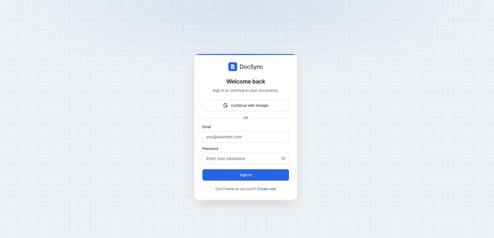
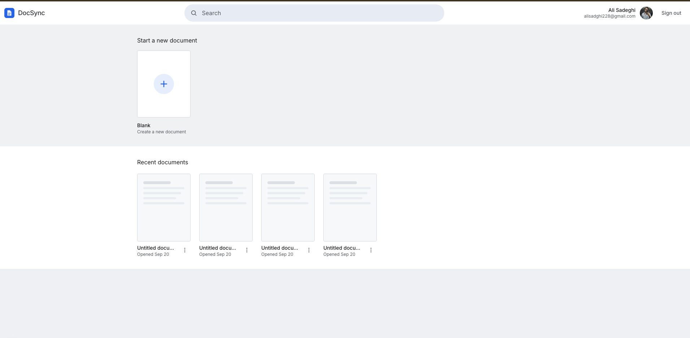

# DocSync

A Google Docs–style editor built as a full-stack YouTube tutorial. Sign in, open a letter-sized page, type with someone else in real time, and share a view-only link — all on Next.js, with no custom WebSocket server.

<p align="center">
  
</p>

<p align="center">
  
</p>

## What you build in the video

- **Auth** — email and password, plus Google OAuth, with sessions that survive a refresh
- **Dashboard** — a Docs-like homepage: search, Blank card, recent documents, rename and delete
- **Editor UI** — title bar, File / Edit / Insert / Format menus, icon toolbar, and a white US Letter page
- **Live editing** — two windows on the same document stay in sync through Liveblocks and Tiptap
- **Presence** — colored live cursors with name labels, and avatars next to Share
- **Share** — anyone with the link can read the document. No account required. They cannot edit.

## Stack

| Layer | Choice | Why |
| --- | --- | --- |
| App | Next.js 16 (App Router) | UI, server actions, and API routes in one project |
| Editor | Tiptap 3 | Headless rich text with an official Liveblocks extension |
| Realtime | Liveblocks | Yjs sync, presence, and live cursors without a custom socket server |
| Auth | Auth.js v5 | Credentials + Google. Not Supabase Auth |
| Database | Supabase Postgres + Prisma | Users and document metadata only |
| Client cache | TanStack Query | Dashboard list, rename, delete |
| Style | Tailwind CSS v4 | Spacing and colors close to Google Docs |
| Host | Vercel | One deploy for the app and the auth/liveblocks routes |

**Boundary to keep clear:** TanStack Query talks to your Postgres metadata. Liveblocks owns the live document body. Those two jobs do not mix.

## How it fits together

1. Auth.js signs the user in. The dashboard loads their documents from Postgres through Prisma.
2. Opening a file wraps Tiptap in a Liveblocks room whose id is the document id.
3. `/api/liveblocks-auth` checks the session and that the user owns that document, then mints a room token.
4. Keystrokes go out as small Yjs updates. Everyone in the room merges them automatically.
5. Presence is rendered as a caret + name in the page, and as overlapping avatars beside Share.
6. Share snapshots the current HTML into Postgres and mints a secret `/share/<token>` URL. That page is view-only and skips login.

## Tutorial chapters

Each chapter is a git branch. Check one out to land on the exact state of that part of the video.

| # | Branch | Chapter |
| --- | --- | --- |
| 1 | `01-project-setup-and-auth` | Project setup and authentication |
| 2 | `02-dashboard-and-document-crud` | Dashboard and document CRUD |
| 3 | `03-google-docs-ui-shell` | Google Docs editor UI |
| 4 | `04-realtime-collaborative-editing` | Real-time editing with Liveblocks and Tiptap |
| 5 | `05-presence-and-live-cursors` | Live cursors and presence avatars |
| 6 | `06-public-read-only-share` | Public view-only share link |

```bash
git checkout 04-realtime-collaborative-editing
```

Chapter notes (what shipped, and files in the order they were added) live in `docs/<branch-name>.md`.

## Run it locally

**Need:** Node.js 20+, a [Supabase](https://supabase.com) project (Postgres only), a [Liveblocks](https://liveblocks.io) secret key, and optional Google OAuth credentials.

```bash
git clone <your-fork-or-this-repo>
cd google-docs-clone
npm install
cp .env.example .env
```

Fill `.env`, then:

```bash
npx prisma migrate deploy
npm run dev
```

Open [http://localhost:3000](http://localhost:3000).

### Environment variables

Copy from `.env.example`. Never commit `.env`.

| Variable | Where it comes from |
| --- | --- |
| `DATABASE_URL` | Supabase → Connect → Transaction pooler (`6543`, `?pgbouncer=true`) |
| `DIRECT_URL` | Supabase → Connect → Session pooler (`5432`, `?sslmode=require`) |
| `AUTH_SECRET` | `openssl rand -base64 32` |
| `AUTH_URL` | `http://localhost:3000` locally |
| `AUTH_GOOGLE_ID` / `AUTH_GOOGLE_SECRET` | Google Cloud → Credentials → Web client. Redirect URI: `http://localhost:3000/api/auth/callback/google` |
| `LIVEBLOCKS_SECRET_KEY` | Liveblocks dashboard → API keys → **secret**. Server only |
| `NEXT_PUBLIC_SUPABASE_URL` / `NEXT_PUBLIC_SUPABASE_PUBLISHABLE_KEY` | Supabase project URL and publishable key (they identify the project; Prisma still needs the Postgres URLs) |

Do **not** turn on Google inside Supabase Auth. Google sign-in is handled entirely by Auth.js.

### Scripts

```bash
npm run dev          # Next.js dev server
npm run build        # prisma generate && next build
npm start            # production server
npx prisma migrate deploy
```

## What this project does not include

The original outline left comments, notifications, version history, and role-based invites as a later Part 2. This repo stops at a public **view-only** share link. Live document content lives in Liveblocks; the share page shows the HTML snapshot taken when the owner last clicked Share.

## License

Built as a tutorial companion. Use and remix it for learning and your own videos.
